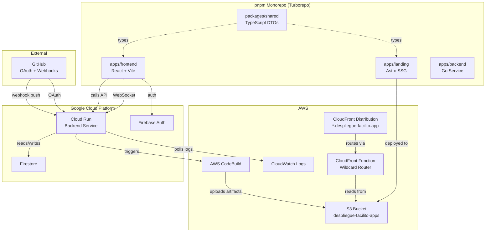
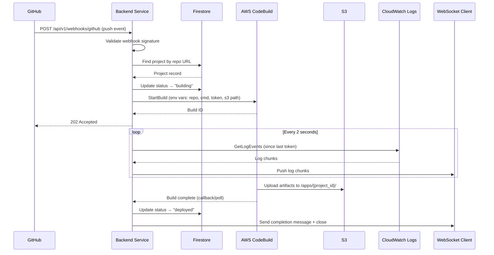
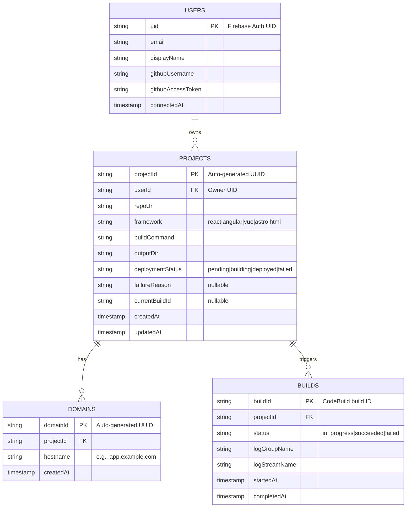

# Design Document: Despliegue Facilito

## Overview

Despliegue Facilito is a developer PaaS that automates static and frontend application deployments on AWS. The system is structured as a pnpm monorepo with Turborepo, containing:

- **Landing App** (Astro SSG): Marketing site deployed on S3 + CloudFront
- **Dashboard App** (React SPA): Authenticated project management, build monitoring, and domain configuration
- **Backend Service** (Go): REST API and WebSocket server on Google Cloud Run, integrating with Firestore, AWS CodeBuild, S3, and CloudWatch Logs
- **Shared Package** (TypeScript): Common API DTOs and entity types

The platform enables developers to connect GitHub repositories, automatically detect frontend frameworks, trigger build pipelines via CodeBuild, serve deployed apps via wildcard subdomains on CloudFront, and stream real-time build logs via WebSocket.

### Key Design Decisions

| Decision | Choice | Rationale |
|----------|--------|-----------|
| Monorepo tool | pnpm + Turborepo | Efficient dependency management, topological build ordering, caching |
| Landing framework | Astro SSG | Zero JS by default, fast static output, ideal for marketing pages |
| Dashboard framework | React + Vite + Tailwind | Fast dev experience, ecosystem maturity, utility-first styling |
| Backend language | Go | Low-latency HTTP/WebSocket, strong AWS SDK, Cloud Run fit |
| Database | Firestore | Serverless, real-time capable, easy integration with Firebase Auth |
| Auth | Firebase Auth | Google OAuth + Email/Password, SDK for both frontend and token verification in Go |
| CI/CD pipeline | AWS CodeBuild | Native S3 artifact upload, CloudWatch Logs integration |
| Hosting | CloudFront + S3 | Global CDN, wildcard domain support via CloudFront Functions |
| Log streaming | WebSocket + CloudWatch Logs polling | Low-latency push to client, no additional infrastructure |

## Architecture



### Request Flow: Deployment Trigger



## Components and Interfaces

### 1. Landing App (`apps/landing`)

**Technology**: Astro 4.x, SSG output, Tailwind CSS

**Responsibilities**:
- Render marketing pages (hero, features, CTA)
- Link to Dashboard signup/login
- Responsive design (320px–1920px)

**Build**: `astro build` → `dist/` static files → S3 + CloudFront

---

### 2. Dashboard App (`apps/frontend`)

**Technology**: React 18+, Vite 5+, Tailwind CSS, Firebase SDK

**Responsibilities**:
- User authentication (Google OAuth, Email/Password)
- Project CRUD (list, create)
- GitHub account connection (OAuth flow)
- Build log streaming (WebSocket client)
- Domain mapping management
- Protected route guards

**Key Modules**:

| Module | Path | Responsibility |
|--------|------|---------------|
| AuthProvider | `src/contexts/AuthContext.tsx` | Firebase Auth state, session persistence |
| ProtectedRoute | `src/components/ProtectedRoute.tsx` | Redirect unauthenticated users to login |
| ProjectList | `src/pages/Projects.tsx` | Fetch and display user projects |
| BuildLogs | `src/components/BuildLogs.tsx` | WebSocket connection, log rendering |
| DomainManager | `src/components/DomainManager.tsx` | CRUD for custom domain mappings |
| GitHubConnect | `src/components/GitHubConnect.tsx` | OAuth flow initiation and status display |

**API Client Interface**:
```typescript
interface ApiClient {
  getProjects(): Promise<ProjectListResponse>;
  createProject(repoUrl: string): Promise<ProjectResponse>;
  getDomains(projectId: string): Promise<DomainListResponse>;
  addDomain(projectId: string, hostname: string): Promise<DomainResponse>;
  deleteDomain(projectId: string, domainId: string): Promise<void>;
  connectGitHub(code: string): Promise<GitHubConnectionResponse>;
}
```

---

### 3. Backend Service (`apps/backend`)

**Technology**: Go 1.22+, Chi router, Firebase Admin SDK, AWS SDK for Go v2

**Responsibilities**:
- REST API for projects, domains, webhooks
- GitHub OAuth token exchange and storage
- Framework detection from `package.json`
- AWS CodeBuild job triggering
- CloudWatch Logs polling and WebSocket streaming
- Webhook signature validation

**REST API Endpoints**:

| Method | Path | Description |
|--------|------|-------------|
| GET | `/health` | Health check (200 OK) |
| GET | `/api/v1/projects` | List user projects |
| POST | `/api/v1/projects` | Create project |
| POST | `/api/v1/projects/{project_id}/domains` | Add domain mapping |
| GET | `/api/v1/projects/{project_id}/domains` | List domain mappings |
| DELETE | `/api/v1/projects/{project_id}/domains/{domain_id}` | Remove domain mapping |
| POST | `/api/v1/webhooks/github` | Receive GitHub webhook |
| GET | `/api/v1/projects/{project_id}/logs` | WebSocket upgrade for build logs |

**Internal Component Interfaces (Go)**:

```go
// FrameworkDetector identifies the frontend framework from package.json
type FrameworkDetector interface {
    Detect(ctx context.Context, repoURL string, token string) (Framework, error)
}

// Framework holds detection result with build configuration
type Framework struct {
    Name         string // "react", "angular", "vue", "astro", "html"
    BuildCommand string // e.g., "npm run build"
    OutputDir    string // e.g., "dist"
}

// BuildService manages CodeBuild job lifecycle
type BuildService interface {
    TriggerBuild(ctx context.Context, project Project) (buildID string, err error)
    GetBuildStatus(ctx context.Context, buildID string) (BuildStatus, error)
}

// LogStreamer polls CloudWatch and pushes to WebSocket
type LogStreamer interface {
    StreamLogs(ctx context.Context, buildID string, conn *websocket.Conn) error
}

// ProjectStore manages project persistence in Firestore
type ProjectStore interface {
    Create(ctx context.Context, userID string, project Project) error
    ListByUser(ctx context.Context, userID string) ([]Project, error)
    GetByRepoURL(ctx context.Context, repoURL string) (*Project, error)
    UpdateStatus(ctx context.Context, projectID string, status string, reason string) error
}

// DomainStore manages domain mapping persistence
type DomainStore interface {
    Add(ctx context.Context, projectID string, hostname string) (Domain, error)
    ListByProject(ctx context.Context, projectID string) ([]Domain, error)
    Delete(ctx context.Context, projectID string, domainID string) error
    GetByHostname(ctx context.Context, hostname string) (*Domain, error)
}

// WebhookHandler validates and processes GitHub webhook events
type WebhookHandler interface {
    ValidateSignature(payload []byte, signature string) error
    Process(ctx context.Context, payload GitHubPushEvent) error
}
```

---

### 4. Shared Package (`packages/shared`)

**Technology**: TypeScript 5+, tsup or tsc for compilation

**Responsibilities**:
- Define API DTO types for all endpoints
- Define entity types (Project, User, Build, Domain)
- Provide type-safe contract between frontend and backend

**Entry Point**: `package.json` → `"exports": { ".": { "types": "./dist/index.d.ts" } }`

---

### 5. Wildcard Router (CloudFront Function)

**Technology**: CloudFront Functions (JavaScript ES5.1 runtime)

**Responsibilities**:
- Parse host header to extract `project_id`
- Rewrite origin request path to `/apps/{project_id}/{path}`
- Pass-through bare domain requests

```javascript
// CloudFront Function (viewer-request)
function handler(event) {
    var request = event.request;
    var host = request.headers.host.value;
    var parts = host.split('.');

    // Bare domain: pass through
    if (parts.length <= 2) {
        return request;
    }

    var projectId = parts[0];
    var path = request.uri === '/' ? '/index.html' : request.uri;

    request.uri = '/apps/' + projectId + path;
    return request;
}
```

---

### 6. Build Pipeline (AWS CodeBuild)

**Technology**: AWS CodeBuild, `buildspec.yml` template

**Responsibilities**:
- Clone repository using provided GitHub token
- Run framework-specific build command
- Upload output directory contents to S3

```yaml
# buildspec.yml template
version: 0.2
phases:
  install:
    runtime-versions:
      nodejs: 20
    commands:
      - npm ci
  build:
    commands:
      - $BUILD_COMMAND
  post_build:
    commands:
      - aws s3 sync $OUTPUT_DIR s3://despliegue-facilito-apps/$PROJECT_ID/ --delete
```

## Data Models

### Firestore Collections



### TypeScript Entity Types (Shared Package)

```typescript
export interface User {
  uid: string;
  email: string;
  displayName: string;
  githubUsername?: string;
}

export interface Project {
  projectId: string;
  userId: string;
  repoUrl: string;
  framework: 'react' | 'angular' | 'vue' | 'astro' | 'html';
  buildCommand: string;
  outputDir: string;
  deploymentStatus: 'pending' | 'building' | 'deployed' | 'failed';
  failureReason?: string;
  currentBuildId?: string;
  createdAt: string; // ISO 8601
  updatedAt: string;
}

export interface Domain {
  domainId: string;
  projectId: string;
  hostname: string;
  createdAt: string;
}

export interface Build {
  buildId: string;
  projectId: string;
  status: 'in_progress' | 'succeeded' | 'failed';
  logGroupName: string;
  logStreamName: string;
  startedAt: string;
  completedAt?: string;
}
```

### API DTOs (Shared Package)

```typescript
// Projects
export interface CreateProjectRequest {
  repoUrl: string;
}

export interface ProjectResponse {
  project: Project;
}

export interface ProjectListResponse {
  projects: Project[];
}

// Domains
export interface AddDomainRequest {
  hostname: string;
}

export interface DomainResponse {
  domain: Domain;
}

export interface DomainListResponse {
  domains: Domain[];
}

// GitHub
export interface GitHubConnectionResponse {
  username: string;
}

// WebSocket Messages
export interface LogChunkMessage {
  type: 'log';
  timestamp: string;
  message: string;
}

export interface LogCompletionMessage {
  type: 'complete';
  status: 'succeeded' | 'failed';
}

export interface LogErrorMessage {
  type: 'error';
  message: string;
}

// Error Response
export interface ErrorResponse {
  error: string;
  message: string;
}
```


## Correctness Properties

*A property is a characteristic or behavior that should hold true across all valid executions of a system — essentially, a formal statement about what the system should do. Properties serve as the bridge between human-readable specifications and machine-verifiable correctness guarantees.*

### Property 1: Framework detection correctness

*For any* valid `package.json` object (with any combination of dependencies and devDependencies), the Framework_Detector SHALL return the framework with the highest priority among recognized dependencies (Angular > React > Vue > Astro), or "html" if no recognized framework dependency is present or if the input is null/unparseable.

**Validates: Requirements 6.2, 6.3, 6.4, 6.5, 6.6, 6.7, 6.8**

### Property 2: Wildcard routing URL rewrite

*For any* HTTP request with a host header of `{project_id}.despliegue-facilito.app`, the Wildcard_Router SHALL rewrite the origin path to `/apps/{project_id}/index.html` when the request path is `/`, and to `/apps/{project_id}/{requested_path}` (preserving query strings) when the path is not `/`. For requests with the bare domain `despliegue-facilito.app` (no subdomain), the request SHALL pass through unchanged.

**Validates: Requirements 8.3, 8.4, 8.5**

### Property 3: Webhook signature validation

*For any* byte payload and webhook secret, the Webhook_Handler SHALL accept the request only when the provided `X-Hub-Signature-256` header matches the HMAC-SHA256 of the payload computed with the configured secret. For any payload where the signature is missing or does not match, the handler SHALL reject with HTTP 401.

**Validates: Requirements 9.2, 9.3**

### Property 4: Webhook invalid payload rejection

*For any* string that is not valid JSON or does not conform to the expected GitHub event structure, the Webhook_Handler SHALL respond with HTTP status 400 without triggering any build.

**Validates: Requirements 9.4**

### Property 5: Webhook non-target event filtering

*For any* valid GitHub webhook payload that is either not a `push` event or not targeting the `main` branch, the Webhook_Handler SHALL respond with HTTP status 200 and SHALL NOT trigger the Build_Pipeline.

**Validates: Requirements 9.5**

### Property 6: Build queue sequential execution

*For any* sequence of N build triggers for the same Project where a build is already in progress, builds SHALL execute sequentially — no two builds for the same Project SHALL have overlapping execution windows.

**Validates: Requirements 7.7**

### Property 7: WebSocket reconnection exponential backoff

*For any* series of WebSocket disconnections (up to 5), the Dashboard_App reconnection delays SHALL follow exponential backoff: attempt K uses delay `2^(K-1)` seconds (1s, 2s, 4s, 8s, 16s), and no more than 5 reconnection attempts SHALL be made.

**Validates: Requirements 10.5**

### Property 8: Hostname validation

*For any* string input, the domain hostname validator SHALL accept only well-formed hostnames conforming to RFC 1123 (labels of 1–63 alphanumeric/hyphen characters separated by dots, total length ≤ 253, no leading/trailing hyphens in labels). All non-conforming strings SHALL be rejected.

**Validates: Requirements 11.1**

## Error Handling

### Backend Service Error Strategy

| Scenario | Response | Recovery |
|----------|----------|----------|
| Unauthenticated request | HTTP 401 + `ErrorResponse` | Client redirects to login |
| Unauthorized access (wrong owner) | HTTP 403 + `ErrorResponse` | Client displays permission error |
| Resource not found | HTTP 404 + `ErrorResponse` | Client displays not found message |
| Duplicate resource (repo/domain) | HTTP 409 + `ErrorResponse` | Client displays conflict message |
| Invalid request body | HTTP 400 + `ErrorResponse` | Client displays validation errors |
| Webhook signature invalid | HTTP 401 (no body) | GitHub retries per webhook config |
| CodeBuild trigger failure | Log error, set status "failed" | User can retry via dashboard |
| CloudWatch Logs unavailable | Send `LogErrorMessage` via WS, retry next poll | Auto-recovery on next 2s cycle |
| Firestore unavailable | HTTP 503 + `ErrorResponse` | Client retries with backoff |
| GitHub API unavailable | HTTP 502 + `ErrorResponse` | User retries connection |

### Dashboard App Error Strategy

| Scenario | Handling |
|----------|----------|
| Firebase Auth unreachable | Display connectivity error, show retry button |
| API request fails (network) | Display error toast, allow retry |
| API returns 401 | Clear session, redirect to login |
| API returns 403 | Display permission denied message |
| WebSocket disconnects | Exponential backoff reconnection (1s base, 5 max attempts) |
| WebSocket max retries exceeded | Display "connection lost" banner, manual retry button |
| OAuth flow failure | Display error, return to pre-connection state |

### Startup Failure Handling (Backend)

```
Startup sequence:
1. Load configuration from environment
2. Initialize Firestore client → failure: log + exit(1)
3. Initialize AWS SDK clients → failure: log + exit(1)
4. Register routes
5. Start HTTP server on PORT (default 8080)
```

Cloud Run will restart the container automatically on non-zero exit, providing crash-loop recovery.

## Testing Strategy

### Unit Tests

**Go Backend (`apps/backend`)**:
- Framework detection logic (table-driven tests with various package.json inputs)
- Webhook signature computation and validation
- Webhook payload parsing and event filtering
- Hostname validation logic
- Build queue ordering logic
- URL rewriting logic (CloudFront Function, tested in isolation)
- Route handler response codes for auth/authz edge cases

**TypeScript Dashboard (`apps/frontend`)**:
- Auth context state management (mock Firebase)
- Protected route redirect behavior
- WebSocket reconnection timing logic
- API client error handling

**TypeScript Shared (`packages/shared`)**:
- Type compilation check (`tsc --noEmit`)

### Property-Based Tests

**Library**: Go — `pgregory.net/rapid` (for backend); TypeScript — `fast-check` (for frontend)

**Configuration**: Minimum 100 iterations per property test.

Each property-based test references its design property using the tag format:

```
// Feature: despliegue-facilito, Property {N}: {property_text}
```

| Property | Component | Generator Strategy |
|----------|-----------|-------------------|
| P1: Framework detection | Backend (Go) | Generate random `package.json` objects with arbitrary deps including/excluding known frameworks |
| P2: Wildcard routing | CloudFront Function (JS) or Backend (Go) | Generate random project_id strings (alphanumeric), random URL paths, and query strings |
| P3: Webhook signature | Backend (Go) | Generate random byte payloads (1B–1MB) and random secrets, compute valid/invalid HMAC |
| P4: Invalid payload rejection | Backend (Go) | Generate random non-JSON strings, truncated JSON, and JSON missing required fields |
| P5: Non-target event filtering | Backend (Go) | Generate random GitHub event types and branch names excluding "push" on "main" |
| P6: Build queue sequential | Backend (Go) | Generate random sequences of 2–10 build triggers with random timing |
| P7: WebSocket backoff | Frontend (TS) | Generate random sequences of 1–5 disconnection events, verify timing |
| P8: Hostname validation | Backend (Go) | Generate random strings mixing valid/invalid hostname characters, verify accept/reject |

### Integration Tests

- **API endpoints**: HTTP tests against running backend with mocked Firestore and AWS clients
- **GitHub OAuth flow**: Mocked GitHub OAuth token exchange
- **CodeBuild triggering**: Verify correct `StartBuild` parameters with mocked AWS SDK
- **CloudWatch Logs polling**: Verify polling interval and log chunk delivery with mocked CloudWatch
- **WebSocket log streaming**: End-to-end WebSocket connection test with mock log data
- **S3 artifact upload**: Verify buildspec.yml generates correct S3 sync commands

### Smoke Tests

- Monorepo structure (workspace files, paths, turbo.json)
- Landing App builds successfully with Astro SSG
- Dashboard App builds successfully with Vite
- Backend Service compiles and starts (health check)
- Shared Package compiles without TypeScript errors
- Docker image builds successfully
- CloudFront Function deploys without syntax errors

### End-to-End Tests

- Full deployment flow: create project → detect framework → trigger build → verify S3 artifacts → verify subdomain access
- GitHub webhook → build trigger → log streaming → deployment completion
- Custom domain addition → DNS instruction display
